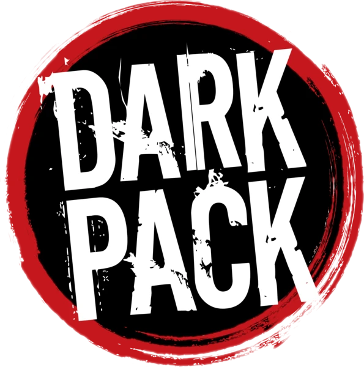

<p><a href="https://www.paradoxinteractive.com/games/world-of-darkness/community/dark-pack-agreement"></a></p>

# El Expediente Ward — una crónica en Seattle (fan, no oficial)

Módulo fan y **no oficial** de **Foundry VTT** para **Vampiro: La Mascarada 5ª edición** sobre
el sistema **wod5e**, publicado bajo el Dark Pack. Trae la ciudad de Seattle en noviembre de
2026, sus Vástagos y la aventura *El Expediente Ward*, con la Segunda Inquisición (FIRSTLIGHT)
jugable con reglas de *Cazador: La Venganza*.

> This is not official World of Darkness material.

**In English — *The Ward File*.** An unofficial fan chronicle for *Vampire: The Masquerade 5th
Edition* (wod5e system) set in Seattle, November 2026, with the Second Inquisition (FIRSTLIGHT)
playable under *Hunter: The Reckoning* rules. The whole chronicle is available in **Spanish and
English**: the Storyteller picks the language when importing, and can switch it mid-campaign
without losing anything (player characters, revealed handouts, tokens, the Thermometer). Install
it with the manifest URL below; the Storyteller's guide in English is `narrator-guide.html` on
each release page.

| | |
|---|---|
| Sistema | wod5e ≥ 5.3.0 |
| Foundry | v14 (verificado en 14.365) |
| Idioma | español |
| Mesa | coterie de 4–5 jugadores |
| Estado | 2.0.0 — la crónica completa importable en castellano o en inglés, el Panel del Narrador, FIRSTLIGHT jugable, 21 mapas pintados con luces, muros y tokens, música de ambiente por escena y la Guía del Narrador. Plan y fases en `SPEC.md` |

## Cómo instalarlo

El módulo **no está en el listado oficial de foundryvtt.com**. La
[política de IA de Foundry](https://foundryvtt.com/article/ai-policy) pide que el contenido
preparado de los paquetes del listado y del marketplace oficiales (texto, imágenes, audio) sea
obra humana, y todo el arte de este módulo está generado con IA (ver [Licencias](#licencias)).
La misma política deja publicar por fuera de esos canales, así que se instala a mano, pegando la
URL del manifiesto:

1. En la pantalla de configuración de Foundry, pestaña de módulos (*Add-on Modules*), tocá
   **Instalar módulo** (*Install Module*).
2. Abajo, en el campo de la URL del manifiesto (*Manifest URL*), pegá
   `https://github.com/mvolgyi/seattle-by-night/releases/latest/download/module.json`
   y tocá **Instalar**.
3. Activalo en un mundo de *wod5e*: la primera vez que entra el Narrador, ofrece importar la
   crónica.

Las actualizaciones llegan solas por el mismo manifiesto. La Guía del Narrador
(`guia-del-narrador.html`) se baja aparte, desde la página de cada release.

Es **gratis** y lo va a seguir siendo. Si en algún momento se aceptan donaciones, van aparte:
no compran nada exclusivo ni adelantado, todo el contenido es el mismo para todos.

## Estructura del repositorio

```
module.json          manifest
src/module/          código del módulo (ES modules, ApplicationV2)
src/styles/sbn.css   CSS, todo prefijado con `sbn-`
templates/           plantillas Handlebars
lang/                es.json
content/             FUENTE ÚNICA: crónica, ciudad, documentos, PNJs, planos…
packs-src/           fuente versionable de los compendios (JSON generado)
packs/               compendios compilados (LevelDB) — GITIGNORED
assets/              mapas, retratos, tokens, tiles, handouts, música (assets/musica/*.ogg)
tools/               build, verificación, arte local (ComfyUI), release
Seattle by Night - El Expediente Ward/   los documentos de origen (.docx)
```

```bash
npm install
npm run verificar     # _key, _id y assets de packs-src/
npm run e2e           # prueba contra un Foundry local (ver tools/e2e/prueba.mjs)
```

Cambiar `module.json` exige reiniciar el servidor de Foundry; cambiar JS/CSS/plantillas, F5.

### Desarrollo local

El repo se enlaza en los datos de Foundry y se prueba en el mundo `sbn-test`:

```bash
ln -s "$PWD" ~/.local/share/FoundryVTT/Data/modules/seattle-by-night
cd ~/FoundryVTT/app/resources/app && node main.js --port=30099 --noupnp --world=sbn-test
```

### La Guía del Narrador (`guia/`)

Una página local con toda la crónica, como la de DVV: el libro (la verdad y el esquema, cómo
usarlo, seguridad, la ficción de apertura, los PJs, los ganchos y el registro de IDs), la
aventura escena por escena con los interludios de FIRSTLIGHT, los desenlaces y el epílogo, el
Termómetro con sus umbrales y el Reloj noche por noche, las pistas, cada PJ y PNJ con su
retrato, los PNJs menores, la ciudad lugar por lugar con los mapas de las escenas, los
documentos y ayudas maquetados como en Foundry, FIRSTLIGHT con la Célula Puget y su arsenal,
la Pantalla del Narrador y cómo se usa el módulo en Foundry (con capturas de las pruebas e2e en
`assets/guia/capturas/`).

Se abre con doble clic en `guia/index.html`, sin internet y sin nada al lado: es un solo
archivo con el CSS (el de la guía y el del módulo), el JS, las fuentes y las imágenes reducidas
embebidas (un navegador Flatpak abre el archivo por el portal y no ve la carpeta). Guarda el
seguimiento de la partida en el navegador (escenas jugadas, Termómetro con su registro, noche
del Reloj, pistas, notas), con exportación a un archivo; los botones del Termómetro y de las
pistas que hay en el texto mueven esa mesa.

No va dentro del módulo: instalada en Foundry, cualquier jugador podría abrirla por URL. Se
publica como un archivo aparte de cada release (`guia-del-narrador.html`, lo arma
`tools/release.mjs` junto al zip) y `guia/index.html` no se commitea.

```bash
npm run contenido    # content/ → packs-src/ (la guía lee el HTML ya generado de los journals)
npm run guia         # packs-src/ + content/ → guia/index.html
node tools/construir-guia.mjs --enlazado   # sin embeber nada, para depurar el CSS y el JS
```

La guía no repite las reglas de los marcadores (`:::leer`, `@tirada`, `@termometro`,
`@pista`, `@reloj`, documentos por soporte): usa el HTML que ya generó
`tools/contenido/journals.mjs` y sólo cambia cada `@UUID[...]` por un enlace a su ancla en la
página. Al terminar avisa si queda algún enlace sin destino o algún marcador sin expandir. Las
imágenes reducidas quedan en `cache/guia/` (ignorado por git).

## Notas de versión

### 2.0.0

- **La crónica en inglés: *The Ward File*.** Toda la crónica (libro, aventura, ciudad,
  personajes, documentos, mapas, Panel y música) se puede jugar en castellano o en inglés. El
  idioma se elige al importar y se puede cambiar con la partida empezada («Idioma de la
  crónica» en la configuración del módulo, o «Actualizar la crónica» en el otro idioma): se
  conservan los PJs, los handouts entregados, los tokens y el estado del Termómetro.
- **Compendios en inglés** en su propia carpeta, «The Ward File»; los de castellano no
  cambian.
- **La interfaz** (Panel, botones, avisos) sale en el idioma de Foundry de cada usuario.
- **Guía del Narrador en inglés:** `narrator-guide.html`, aparte, en cada release.
- **Cómo se traduce:** el castellano sigue siendo la fuente; el inglés vive en `content/en/` y
  lo genera `tools/traducir.mjs` con la API de Claude, con un glosario de términos oficiales de
  V5 y H5 en inglés. Cada traducción guarda la huella del castellano del que salió:
  `npm run verificar:traduccion` avisa qué quedó desactualizado. Plan completo en
  `TRADUCCION.md`.

### 1.1.0

- **Música de ambiente por escena.** Un compendio nuevo, *El Expediente Ward — Música*, con la
  lista «El Expediente Ward — Ambientes»: una pista en loop para cada mapa y para la portada
  (las escenas con el mismo clima comparten pista: los tres pisos de Gale Sentinel, las dos
  plantas del Larchmont, la cubierta de coches y el puente del ferry), más cuatro para lanzar a
  mano (Seattle de noche, Combate, La redada de FIRSTLIGHT, Epílogo). Al activar una escena
  suena su pista; pasar entre dos escenas que la comparten no la corta. Viene en la Aventura:
  «Actualizar la crónica» la agrega a un mundo que ya tenía la 1.0.0. La fuente es
  `content/musica.json`.
- **Actualizar la crónica no pisa la música:** se conservan lo que está sonando, el volumen que
  tocó el Narrador en cada pista y los sonidos agregados a mano.

### 1.0.0

Primera versión completa.

- **La crónica:** el libro, la aventura escena por escena, los interludios de FIRSTLIGHT, los
  desenlaces, la ciudad, 21 documentos y ayudas de juego, PJs y PNJs con retrato y ficha.
- **21 mapas pintados** con muros, puertas, luces, regiones de transición, muebles móviles,
  78 personajes colocados y un pin por escena en la sala donde transcurre.
- **Visión:** los personajes ven según lo que son (a tientas sin luz; Auspex, Protean y gafas
  térmicas ven en la oscuridad; los perros huelen). El Narrador, sin un token seleccionado,
  ve el mapa aclarado aunque la escena sea oscura para los jugadores (ajuste del cliente).
- **Panel del Narrador:** Termómetro con umbrales e interludios, Reloj de ocho noches, pistas
  y las tiradas clave del Consejo y de la jauría.
- **Guía del Narrador:** un HTML aparte (`guia-del-narrador.html` en la release), sin
  internet, con toda la crónica y una mesa de seguimiento.

### Cambios de seguridad (spoilers)

- **Avisos al Narrador sin spoilers.** Foundry manda todos los mensajes de chat a todos los
  clientes (el susurro sólo los oculta en la interfaz). Desde esta versión, los avisos del
  Termómetro, los umbrales, las pistas, el Reloj y el voto al azar guardan un texto neutro y
  sólo claves en un flag; el texto real lo arma el cliente de cada GM al mostrarlos. Los
  mensajes que ya estaban en un mundo conservan su contenido viejo (con el texto completo) y
  no se migran: si te preocupa, vaciá el chat.
- **Estado sin spoilers en los ajustes.** Foundry manda los ajustes del mundo, y cada cambio,
  a todos los jugadores. Los motivos del historial del Termómetro (y qué movimiento fue), las
  pruebas marcadas y los votos del Consejo ahora van sellados y sólo los abre el Narrador; el
  voto al azar tampoco dice quién votó. Las partidas empezadas se convierten solas la primera
  vez que entra el Narrador, sin perder el historial. Es ofuscación, no cifrado: quien lea el
  código del módulo a propósito puede abrirlo.
- **Límite de Foundry.** Foundry manda a cada jugador todos los journals, actores y escenas del
  mundo, aunque no tenga permiso para verlos; los permisos sólo los ocultan en la interfaz.
  Con la consola del navegador abierta, un jugador puede leer la crónica: pasa con cualquier
  aventura de Foundry, no sólo con ésta.

## Licencias

- **Código** (`src/`, `tools/`, `templates/`): MIT, ver `LICENSE`.
- **Contenido de World of Darkness.** Material fan y no oficial de World of Darkness,
  publicado bajo el [Dark Pack](https://www.paradoxinteractive.com/games/world-of-darkness/community/dark-pack-agreement).
  Partes de estos materiales son copyright y marcas registradas de Paradox Interactive AB, y
  se usan con permiso. Todos los derechos reservados. Más información en
  [worldofdarkness.com](https://www.worldofdarkness.com).

  > Portions of the materials are the copyrights and trademarks of Paradox Interactive AB,
  > and are used with permission. All rights reserved. For more information please visit
  > [worldofdarkness.com](https://www.worldofdarkness.com).
  >
  > This is not official World of Darkness material.

  Es gratuito: no se vende. Si se aceptan donaciones, van aparte y sin nada exclusivo.
- **Nombre.** Durante el desarrollo el módulo se llamó «Seattle by Night — El Expediente
  Ward». El nombre visible cambió porque *Seattle by Night* es también el de un show oficial
  con licencia de World of Darkness, y este módulo no tiene que confundirse con material
  oficial. El id (`seattle-by-night`), el repositorio y los ajustes no cambian, para no romper
  los mundos que ya lo tienen.
- **Arte generado con IA.** Todo el arte (mapas, retratos, tokens, tiles e ilustraciones) es
  original y está **generado con IA en local**, con modelos de licencia abierta que permiten
  uso comercial (lista y licencias en `tools/MODELOS.md`). Cada imagen tiene su procedencia
  registrada en `assets/PROCEDENCIA.json`: modelo, licencia, workflow, semilla y prompt. No
  contiene arte oficial de Paradox ni de White Wolf.
- **Traducción al inglés con IA.** El texto en inglés (`content/en/`) es una traducción del
  castellano hecha con la API de Claude (Anthropic) y revisada con controles automáticos de
  formato y terminología; el original es el castellano.
- **Música generada con IA.** Toda la música (`assets/musica/`) es original y está **generada
  en local con ACE-Step 1.5** (licencia MIT, permite uso comercial), sin voces ni muestras de
  terceros. Su procedencia (modelo, licencia, prompt y semilla) está en
  `assets/PROCEDENCIA.json`, como la del arte.
- **Logo del Dark Pack.** El único logo oficial es el del Dark Pack
  (`assets/legal/dark-pack-logo.webp`), que se muestra como lo pide el acuerdo; procedencia en
  `assets/legal/LEEME.md`.
